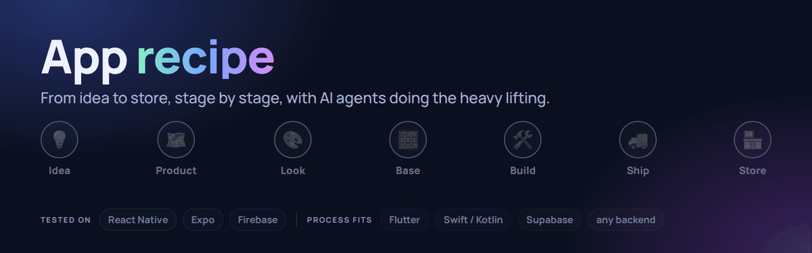
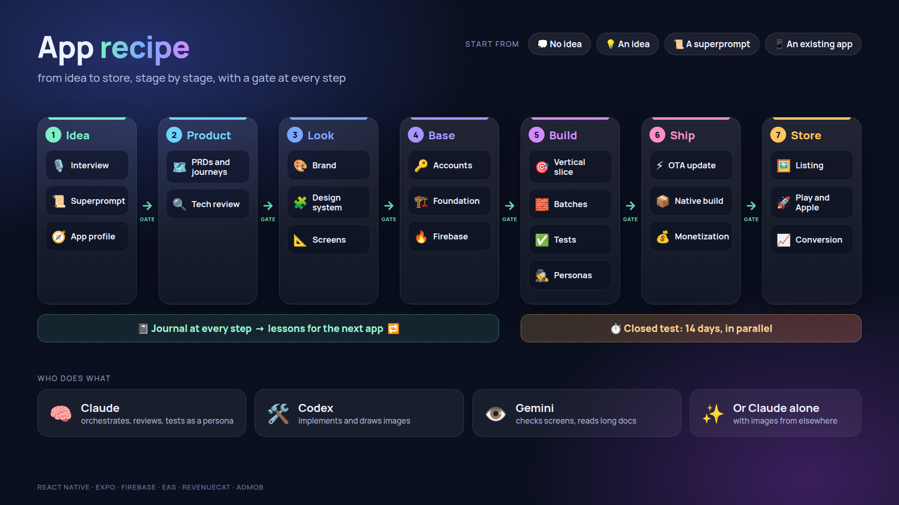
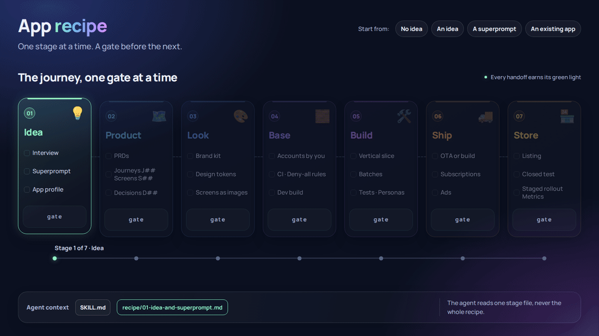
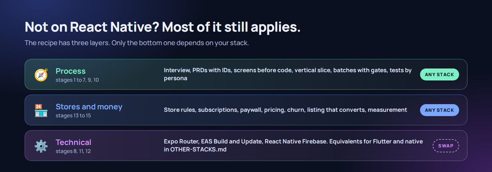
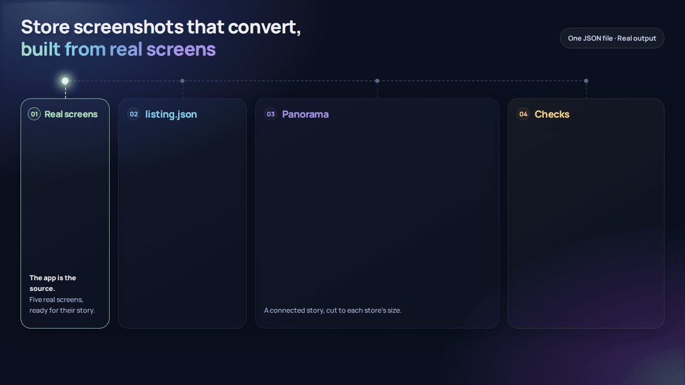
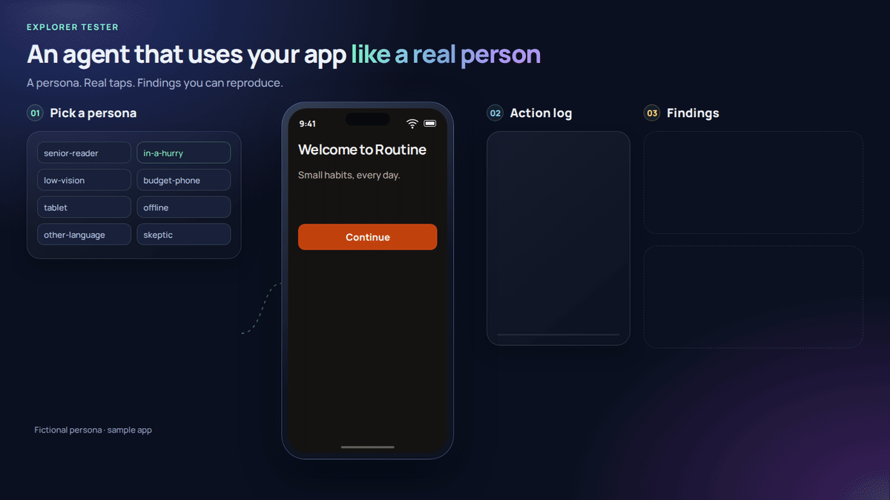
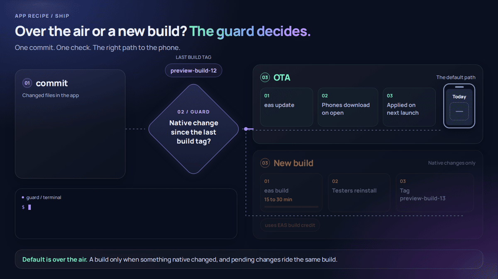

<div align="center">



A skill, a set of subagents and small tools that guide a mobile app from a loose idea to a
published, monetized app on Google Play and the App Store.

[](LICENSE)




</div>

## Why this exists

Building an app with AI agents is fast until it isn't: the agent forgets decisions, screens drift
from the code, a secret ends up in the chat, the store rejects the build, nobody knows whether a
change needs a new build or can go over the air. This recipe is the process that survived several
real apps, written down so an agent (or you) can follow it from the first question to the first
download.

- **Gates, not vibes.** Every stage ends with something measured: "CI green on commit x",
  "contrast 7.3:1", "two journeys with green E2E".
- **Small context.** The agent reads only the file for the current stage, never the whole recipe.
- **You stay the owner.** The agent does the technical work; you decide, pay and sign. Secrets never
  pass through the chat.
- **Real traps included.** About 80 lessons learned, each with its fix (`LESSONS.md`).

## The journey

<p align="center"></p>

| Phase | Stages | You get | Read |
| --- | --- | --- | --- |
| 💡 **Idea** | 1 | An interview, one question at a time, ending in a superprompt and an app profile | [01](recipe/01-idea-and-superprompt.md) |
| 🗺️ **Product** | 2 to 3 | PRDs, journeys (J##) and screens (S##) with IDs; a technical review that turns conflicts into decisions (D##) | [02](recipe/02-prds-journeys-screens.md) · [03](recipe/03-technical-review.md) |
| 🎨 **Look** | 4 to 6 | Name, brand kit by script, design tokens, every screen as an image before code | [04](recipe/04-name-and-brand.md) · [05](recipe/05-design-system.md) · [06](recipe/06-screens.md) |
| 🧱 **Base** | 7 to 8 | Accounts created by you and configured by the agent through APIs; CI, deny-all rules, a dev build with OTA updates | [07](recipe/07-accounts-and-infra.md) · [08](recipe/08-technical-foundation.md) |
| 🛠️ **Build** | 9 to 10 | A vertical slice first, then batches; unit, component, rules and E2E tests; exploratory testing by personas | [09](recipe/09-building-in-batches.md) · [10](recipe/10-testing-and-quality.md) |
| 🚚 **Ship** | 11 to 13 | Over the air vs native build decided by a script; subscriptions and ads that work in test | [12](recipe/12-build-or-ota.md) · [13](recipe/13-monetization.md) |
| 🏪 **Store** | 14 to 15 | A store listing that gets found and converts, the closed test, review, staged rollout, then measurement and conversion work | [14](recipe/14-stores.md) · [listing](recipe/store-listing.md) · [15](recipe/15-after-launch.md) · [measure](recipe/analytics.md) |

## Any stack, any agent

The recipe was built and tested on React Native + Expo + Firebase, but most of it is process and
store knowledge that does not care how the app is written. Using Flutter, Swift, Kotlin or another
backend? Follow the same stages and swap the technical layer with
[OTHER-STACKS.md](OTHER-STACKS.md).

<p align="center"></p>

Already have an app? Start at stage 0, an audit that decides whether to harden or rewrite
([00-map](recipe/00-map.md)). The map also shows which stages your app's profile turns on or off.

## Quick start

**With Claude Code** (recommended)

```bash
git clone https://github.com/Rahgomes/app-recipe ~/.claude/skills/app-recipe
# optional subagents: screen checker, store reviewer, explorer tester
mkdir -p ~/.claude/agents && cp ~/.claude/skills/app-recipe/agents/*.md ~/.claude/agents/
```

Then, in any folder, just talk:

> "I have an idea for an app that reminds people to water their plants."
>
> "Here is my superprompt, take it from there."
>
> "Does this change need a new build or can it go over the air?"
>
> "Get the app ready for the Play Store."

**With Codex CLI**: `git clone https://github.com/Rahgomes/app-recipe ~/.codex/skills/app-recipe`.

**With any other agent, or none**: open [recipe/00-map.md](recipe/00-map.md) and follow the stages.
Each one says what to do, what to produce and how to know it is done.

The agent talks to you and writes your app's docs in your language. The recipe itself is in
English only so it can be shared.

## Working modes

| Mode | Who does what | Best for |
| --- | --- | --- |
| Claude only | Claude plans, codes, reviews; images come from any generator you like | Simplest setup |
| Claude + Codex | Claude orchestrates and reviews; Codex implements and generates images, in parallel | Speed with a second pair of eyes |
| Claude + Codex + Antigravity (Gemini) | Gemini checks generated screens against the spec and digests long documents | Apps with many screens |

Details and the briefing format that keeps a delegated agent from crawling your repo:
[WORKING-MODES.md](WORKING-MODES.md).

## Three tools worth a look

### Store screenshots that convert, built from real screens

Real screenshots go in, a connected panorama comes out, cut to the exact sizes of both stores, with
the Play feature graphic, alt texts, a thumbnail preview (how search shows it) and warnings for what
the stores reject. Text is code, so translating or A/B testing a variant is editing a JSON file.



[recipe/store-listing.md](recipe/store-listing.md) explains what makes people tap install, how
each store ranks apps (ASO) and what gets rejected. Tool:
[tools/store-listing/](tools/store-listing/listing.py), with a ready example.

### An agent that uses your app like a real person

`explorer-tester` drives the web preview (Playwright) or an Android device (adb) as a persona: a
senior with large fonts, someone in a hurry in dark mode, a user who loses the network mid-save, a
phone in another language. No scripts to write; it reports findings with steps and screenshots.



In our own test against a sample app with six planted bugs, one persona run found five of them plus
two we had not planted. Personas and engines: [tools/explorer/](tools/explorer/personas.md).

### Over the air or a new build, decided by a script

Most changes reach phones in minutes through EAS Update; a native change needs a new build, which
costs build credit, takes 15 to 30 minutes and makes testers reinstall. `tools/ota-or-build.sh`
compares what changed since the last build tag with the list of native paths and tells you which
path to take, then publishes over the air when it is safe.



Rules and the runtime version policy: [recipe/12-build-or-ota.md](recipe/12-build-or-ota.md).

## What is inside

| Path | What it has |
| --- | --- |
| [SKILL.md](SKILL.md) | The orchestrator the agent follows (stages, gates, golden rules) |
| [recipe/](recipe/00-map.md) | The stages, 00 to 15, plus subscriptions (paywall, price, offers, churn), store listing, measurement (crashes, analytics, attribution), services catalog, libraries and automation by API |
| [templates/](templates/) | Superprompt, interview, app profile, PRD, decisions and backlog, screen spec, event plan, accounts, briefing, journal |
| [agents/](agents/) | Subagents: `screen-checker`, `store-reviewer`, `explorer-tester` |
| [tools/](tools/) | `new-app-docs.sh`, `contrast.py`, `ota-or-build.sh`, `check-secrets.sh`, `store-listing/`, `explorer/` |
| [LESSONS.md](LESSONS.md) | About 80 real traps, by topic, with the fix |
| [OTHER-STACKS.md](OTHER-STACKS.md) | What carries over to Flutter, native or Supabase, and what changes |
| [DESIGN.md](DESIGN.md) | Why the recipe is shaped this way |

## Your conventions, without forking

Create a `LOCAL.md` next to `SKILL.md` with what is yours only: where you keep secrets, your job
queue, your CI, which agents you use. The skill reads it first and it wins over the generic text.
It is ignored by git, so `git pull` keeps you up to date without conflicts.

## Ground rules for secrets

Keys and tokens live in files outside the repository (mode 600) or in the CI and EAS vaults. The
agent uses them by path or variable name and never prints them. Something pasted in a chat by
mistake gets revoked and reissued on the spot. See
[recipe/automation-by-api.md](recipe/automation-by-api.md) for which credential unlocks which
automation. Before sharing a folder, run `tools/check-secrets.sh <folder>`.

## Evolving

The recipe changes as new apps teach new lessons; the commit history is the changelog. Store rules,
prices and library versions are dated where they appear: check the official source on the day you
act. Issues and pull requests with a real trap and its fix are welcome.

## License

[MIT](LICENSE)
